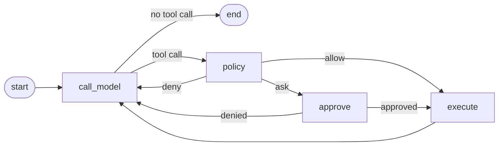

# approval-loop

An agent that pauses before a risky tool call, shows a human an approval card, survives being killed while it waits, and picks up at the same card when restarted. Built on LangGraph's `interrupt()` and a SQLite checkpointer. The policy that decides what is risky was ported from an agent runtime I wrote by hand ([Local Agent X](https://github.com/Local-Agent-X/Local-Agent-X)), so the README ends with an honest comparison of the two.

## The graph



Five nodes, one conditional edge. `policy` is a pure function of `(tool, args, profile, prior approvals, now)`. `approve` calls `interrupt()` with the card and returns a `Command` to route on the answer. `execute` runs the tool and appends a tool message. Every node that ends a tool call decides whether another call from the same model turn is still pending, so a model that emits three tool calls gets three decisions and three tool messages before it runs again.

The graph never changes between scenarios. What changes is a `Rules` table that says which tools are gated and why:

```python
# scenarios/nutrishop.py
Rules(
    gated={"draft_purchase_order": "writes a purchase order"},          # asks under `normal`, allowed under `autonomous`
    irreversible={"send_purchase_order": "commits the store to paying the supplier"},  # always asks
)
```

Two scenarios ship: `dev` (read a file, write a file, run a shell command; the shell is scanned against a destructive-command floor) and `nutrishop` (a supplement store's reorder agent: reading stock is free, drafting a purchase order is gated, sending one to the supplier commits money and always cards).

## Run it

```bash
pip install -e ".[dev]"
export MODEL=anthropic:claude-sonnet-5   # or any init_chat_model id, e.g. ollama:qwen3.6:27b
export ANTHROPIC_API_KEY=...

python run.py --thread demo1 "delete the build directory in the workspace using bash"
#   === APPROVAL NEEDED ===
#   tool:   bash
#   args:   {"command": "rm -rf build"}
#   reason: irreversible: rm -rf
#   approve? [y/N]        <- Ctrl-C here

python run.py --thread demo1 --resume
#   resumed thread 'demo1' from its checkpoint
#   (the same card, same fingerprint)  -> y -> the tool runs, the model finishes
```

The NutriShop scenario, with the owner running autonomous so drafts go through and only money leaving cards:

```bash
python run.py --scenario nutrishop --profile autonomous --thread reorder1 "restock whatever is low"
```

In a real run, three POs were drafted without a card, all three sends carded, the second was denied with the reason *"Ghost raised prices last month, hold that one until I call them"*, and the model's final summary marked that PO on hold and repeated the reason. The order file on disk stayed at `status: draft`.

Studio and the chat UI: `pip install "langgraph-cli[inmem]"` then `langgraph dev`. Both graphs are registered in `langgraph.json`.

## Where LangGraph was cleaner than my hand-rolled version

Two bugs from the runtime I wrote cannot exist here.

1. **An approval wait that lived inside a tool timeout.** My runtime waited for the human *inside* the tool call, so a 30-second tool timeout around a five-minute approval card made every card on a slow page unanswerable. `interrupt()` exits the run. There is no tool in flight while the human thinks; the process can even be gone. The bug has no place to live.
2. **Denial reasons were inferred, not carried.** My runtime stamped machine denials as "declined" and lost the human's words. Here the owner answers the card in plain words (`no, Ghost raised prices last month`), the reason lands in the tool message verbatim, and the model acts on it (see the NutriShop run above). The framework made the right design the easy one.

The card itself is written for the owner, not the developer: each scenario builds a one-line question from the call's own args in code (`Send PO-…-OPT-001 to Optimum for $528.00? Items: 12 x Whey Protein Chocolate 5lb.`), so the model cannot misstate what is about to run. Anything that isn't a clear yes is a no; an unclear answer never sends money.

A third, smaller one: I rebuilt "persist the operation so a pause survives a restart" myself, over weeks. The checkpointer is one line and it also gives me `get_state()` to inspect the pending card from a fresh process, which is exactly what `--resume` does.

## Where the hand-rolled version does something the framework does not give you

The framework pauses and resumes. It has no opinion about *what* to pause on. Everything in `policy.py` is the part you have to bring:

- **The irreversible floor.** A `bash` command is scanned against patterns for `rm -r`, `find -delete`, `xargs rm`, `git push --force`, `git reset --hard`, `dd of=`, `Remove-Item -Recurse`, `rd /s` and so on, split on `|`, `;`, `&&` first so a harmless leading command cannot hide one. Each pattern was added after a model reached for that exact shape in an eval. `git rm` is excluded because the index can undo it.
- **Per-argument fingerprints.** Approval is keyed on `sha256(tool + canonical args)`. Approving `rm -rf build` does not approve `rm -rf src`; approving PO-001 does not approve PO-002.
- **The decline-suppress window.** An identical re-issue within 60 seconds of a denial is denied without a card, with a machine reason (`suppressed: declined 40s ago (keep the cache)`). Models retry; humans should not be asked twice.
- **A profile with a floor above it.** `autonomous` lets gated calls through, but the irreversible floor reclassifies above the profile. That is the difference between "the owner trusts the agent to draft" and "the owner trusts the agent to spend".
- **An action-aware table.** A family tool whose risk varies per `action` argument keeps a `{tool: {action: reason}}` entry so collapsing a family into one tool never weakens its gate.

## Where I would still use my own approach

For the loop itself, LangGraph. I would not write the checkpointer or the interrupt plumbing again; the two bugs above cost me more time than this whole repo took. For the model layer and the security layer, I would still own the code. The hard problems in my runtime were provider-specific (prompt-cache prefixes, local-model tool-call parsing, context sizes) and an in-process security kernel that has to sit on the tool dispatch path; a framework abstraction over exactly those seams is where I kept fighting wrappers instead of writing the fix. So: the framework for the graph, my own code where the framework's abstraction is the thing that needs changing.

## Evals

`tests/test_policy.py` asserts on the policy node directly, no model in the loop: the ten cases from the spec (what must card under `normal`, what must not, what `autonomous` changes and what it cannot), the fingerprint properties, the floor's edge cases on both Unix and Windows shells, and the NutriShop rules. `tests/test_graph.py` runs the graph with a scripted model: the interrupt fires, a second graph instance on the same SQLite file is sitting at the same card, resume executes the tool, a denial's reason reaches the model. `tests/test_nutrishop_graph.py` does the same for the store.

```bash
pytest -q     # 57 passed
```

## Deliberately left out

The security kernel, taint tracking, canaries and the threat engine; memory and retrieval; provider abstraction, local-model handling and prompt caching; background workers and fan-out; the full tool registry. Nothing is imported from the original runtime; `policy.py` was written fresh with its source open in another window.

## LangSmith

Tracing is env-vars only (`LANGSMITH_TRACING`, `LANGSMITH_API_KEY`, `LANGSMITH_PROJECT`); see `.env.example`. Nothing in the code changes when they are set. An interrupted run and its resume show up as two runs on the same thread.
